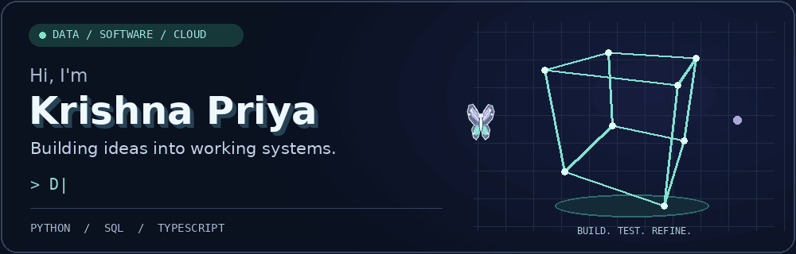
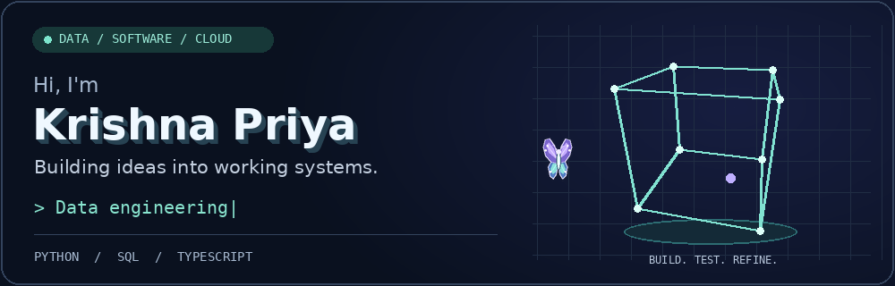

  

### A little about me

I'm **Krishna Priya Kella**, a Computer Science diploma graduate pursuing a **B.Tech in Computer Science & Engineering at Lovely Professional University**.

I build data pipelines, backend services and AI-assisted applications. I enjoy turning an idea into something people can run, understand and improve—then making the setup, tests and documentation clearer.

**Currently exploring:** data quality, reproducible deployments and cloud automation.  
**Looking for:** internships and early-career opportunities in software, data and infrastructure engineering.

[Explore my projects](https://github.com/Krishnapriya1911?tab=repositories) · [LinkedIn](https://www.linkedin.com/in/krishna-priya-kella/)

### Projects I'm building

| Project | What works today | Explore |
| --- | --- | --- |
| **Lakehouse Pipeline** | Reproducible batch reference demo, data-quality checks and an explorer for generated aggregates | [Live explorer](https://lakehouse-pipeline-explorer.krishnapriyakella07.chatgpt.site) · [Code](https://github.com/Krishnapriya1911/lakehouse-data-engineering-pipeline) |
| **Bharat Infra Research** | Evidence API and rule-based research console; 72 tests and Docker smoke checks pass | [Code & setup](https://github.com/Krishnapriya1911/bharat-infra-research) · Hosting pending |
| **CareerIQ** | Career preparation workflows; production build passes, with backend and sign-in verification pending | [Code](https://github.com/Krishnapriya1911/CareerIQ) · Deployment pending |
| **PRIYARA** | Node.js and SQLite web application with authentication, products, orders and messaging routes | [Code](https://github.com/Krishnapriya1911/PRIYARA) · Demo verification pending |

The Lakehouse explorer uses synthetic data and generated reference outputs. It demonstrates batch results; the full streaming/cloud stack is not hosted in that demo.

### My toolbox

**Languages** — Python, SQL, TypeScript, JavaScript  
**Data & backend** — PySpark, Kafka, Delta Lake, FastAPI, Node.js, PostgreSQL  
**Web & workflow** — Next.js, Git, GitHub, Linux, Docker

<strong>What I'm improving right now ↗</strong>

- Making project setup repeatable and checking deployment behaviour.
- Adding useful validation and tests around data pipelines and APIs.
- Explaining project scope, limitations and results honestly.

The repositories contain the current setup instructions and verification notes. A project listed here is not a claim that every integration is production-ready.

<strong>Prefer a still banner?</strong>

---

Curious about data. Careful about how things work. Always building.

